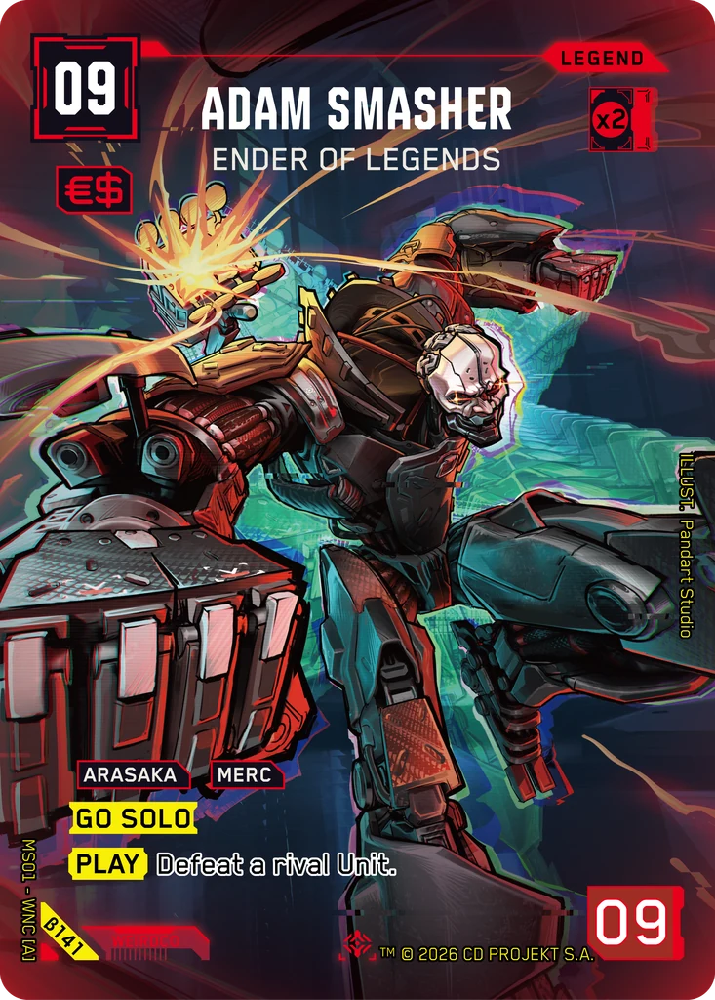
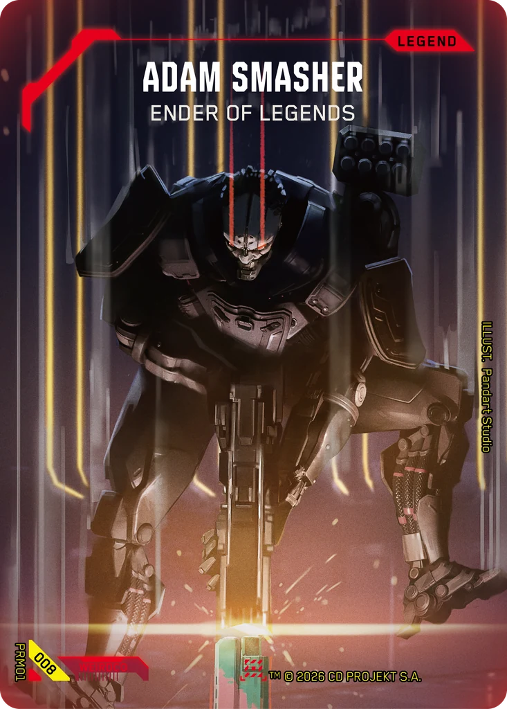

# Adam Smasher - Ender of Legends

**Type:** Legend  
**Rarity:** Iconic Legend #141  
**Printings:** Beta Iconic Legend β141; Retail Iconic Legend 141; Set 1 Promos Nova 008  
**Illustrated by:** Pandart Studio, Jacob Schade

## Images in this folder

| File | Printing |
|---|---|
| [beta-141.webp](beta-141.webp) | Beta Iconic #141 |
| [retail-141.webp](retail-141.webp) | Retail Iconic #141 |
| [nova-008.webp](nova-008.webp) | Nova Rare 008 (Set 1 Promos) |

  

## Full art (linked, not copied)

Out of respect for the Artists and their agreements with ArtStation, their work is linked here instead of re-uploaded.

- https://www.artstation.com/artwork/O3mNay

## Official reveals

- 2026-01-29: [post on X](https://x.com/Cyberpunk_TCG/status/2016919711812923668) · [images in this repo](../../../marketing/x-posts/2026-01-29-2016919711812923668)
- 2026-03-17: [post on X](https://x.com/Cyberpunk_TCG/status/2033941747596718122) · [images in this repo](../../../marketing/x-posts/2026-03-17-2033941747596718122)
- 2026-10-07: [post on X](https://x.com/Cyberpunk_TCG/status/2107939305108750802) · [images in this repo](../../../marketing/x-posts/2026-10-07-2107939305108750802)
