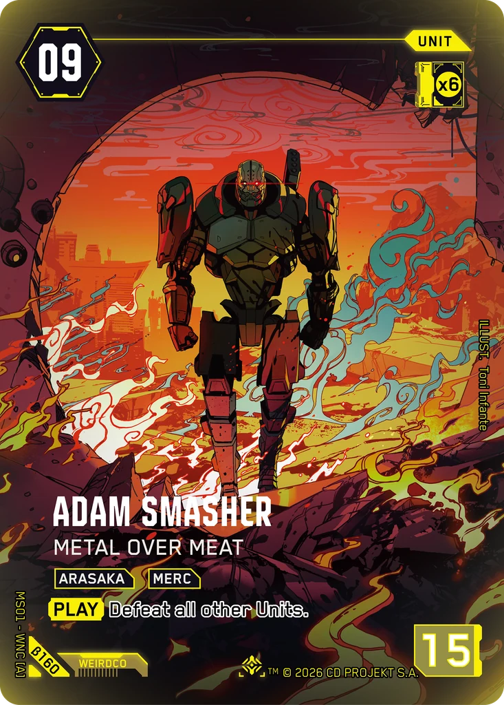
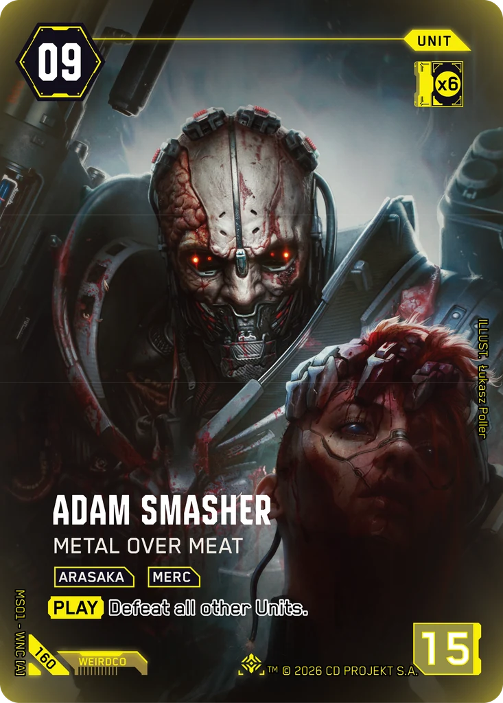
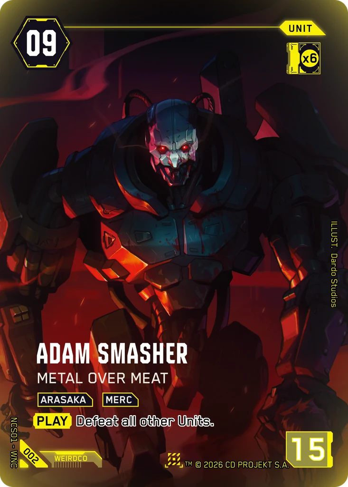

# Adam Smasher - Metal Over Meat

**Type:** Unit  
**Rarity:** Iconic Other #160  
**Printings:** Beta Iconic Other β160; Night City Showdown S1 Nova 002; Retail Iconic Other 160  
**Illustrated by:** Toni Infante, Łukasz Poller, Dardo Studios

## Images in this folder

| File | Printing |
|---|---|
| [beta-160.webp](beta-160.webp) | Beta Iconic #160 |
| [retail-160.webp](retail-160.webp) | Retail Iconic #160 |
| [nova-002.webp](nova-002.webp) | Nova Rare 002 (Night City Showdown S1) |

  

## Full art (linked, not copied)

Out of respect for the Artists and their agreements with ArtStation, their work is linked here instead of re-uploaded.

- https://www.artstation.com/artwork/q0QDWz
- Regular printing art by Dardo Studios: not mirrored here; see the artist's own pages

## Official reveals

- 2026-03-06: [post on X](https://x.com/Cyberpunk_TCG/status/2029965624504393935) · [images in this repo](../../../marketing/x-posts/2026-03-06-2029965624504393935)
- 2026-08-10: [post on X](https://x.com/Cyberpunk_TCG/status/2086845716433911996) · [images in this repo](../../../marketing/x-posts/2026-08-10-2086845716433911996)
- 2026-09-11: [post on X](https://x.com/Cyberpunk_TCG/status/2098517222557720787) · [images in this repo](../../../marketing/x-posts/2026-09-11-2098517222557720787)
