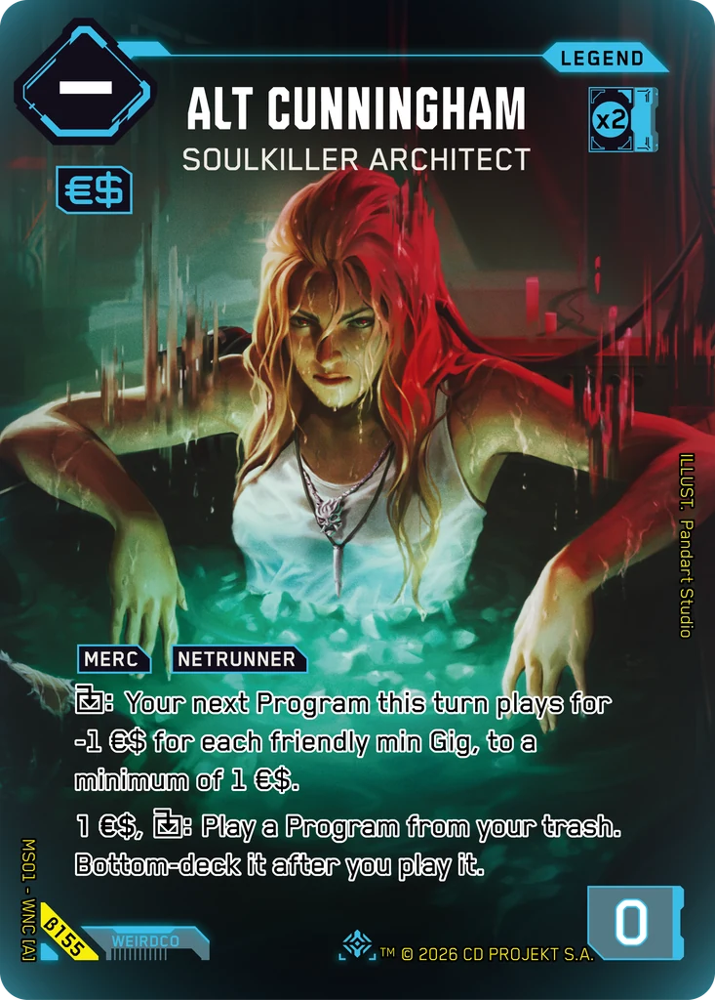
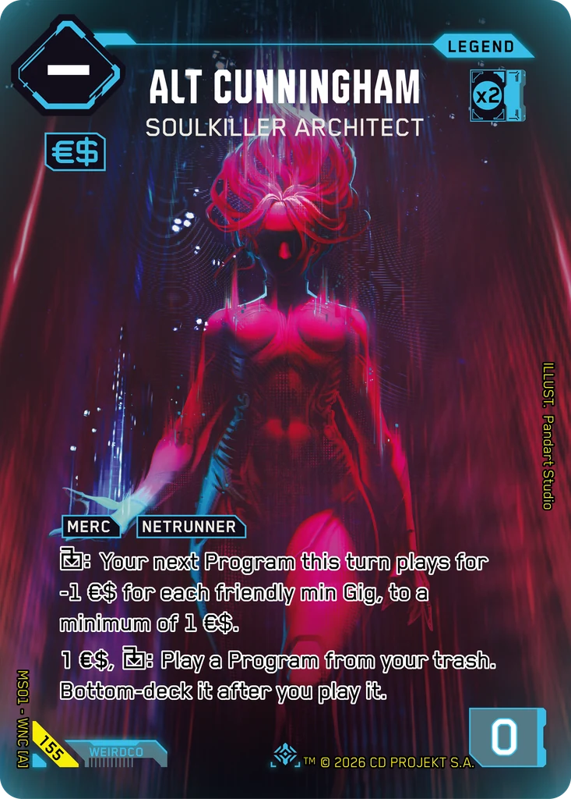
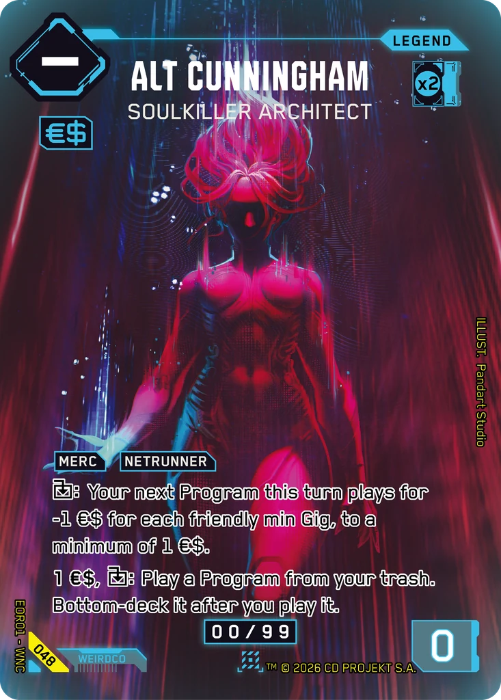

# Alt Cunningham - Soulkiller Architect

**Type:** Legend  
**Rarity:** Iconic Legend #155  
**Printings:** Beta Iconic Legend β155; Edgerunner Open S 1 Nova 048; Retail Iconic Legend 155  
**Illustrated by:** Pandart Studio, Radiance Li, Reinaldo Indrajaya

## Images in this folder

| File | Printing |
|---|---|
| [beta-155.webp](beta-155.webp) | Beta Iconic #155 |
| [retail-155.webp](retail-155.webp) | Retail Iconic #155 |
| [nova-048.webp](nova-048.webp) | Nova Rare 048 (Edgerunner Open S 1) |

  

## Full art (linked, not copied)

Out of respect for the Artists and their agreements with ArtStation, their work is linked here instead of re-uploaded.

- https://www.artstation.com/artwork/o0bZvz
- https://www.artstation.com/artwork/rlxLEG
- https://www.artstation.com/artwork/gRkzkZ

## Official reveals

- 2026-02-27: [post on X](https://x.com/Cyberpunk_TCG/status/2027429086474248342) · [images in this repo](../../../marketing/x-posts/2026-02-27-2027429086474248342)
- 2026-03-14: [post on X](https://x.com/Cyberpunk_TCG/status/2032924884393767119) · [images in this repo](../../../marketing/x-posts/2026-03-14-2032924884393767119)
- 2026-03-17: [post on X](https://x.com/Cyberpunk_TCG/status/2033946041985192130) · [images in this repo](../../../marketing/x-posts/2026-03-17-2033946041985192130)
- 2026-08-24: [post on X](https://x.com/Cyberpunk_TCG/status/2091919275833405618) · [images in this repo](../../../marketing/x-posts/2026-08-24-2091919275833405618)
- 2026-09-07: [post on X](https://x.com/Cyberpunk_TCG/status/2097067661733626090) · [images in this repo](../../../marketing/x-posts/2026-09-07-2097067661733626090)
