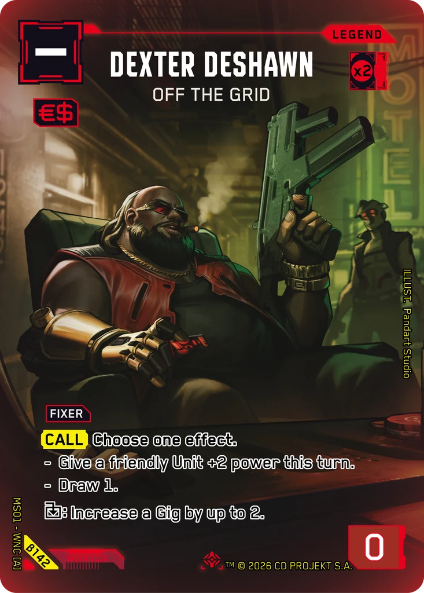
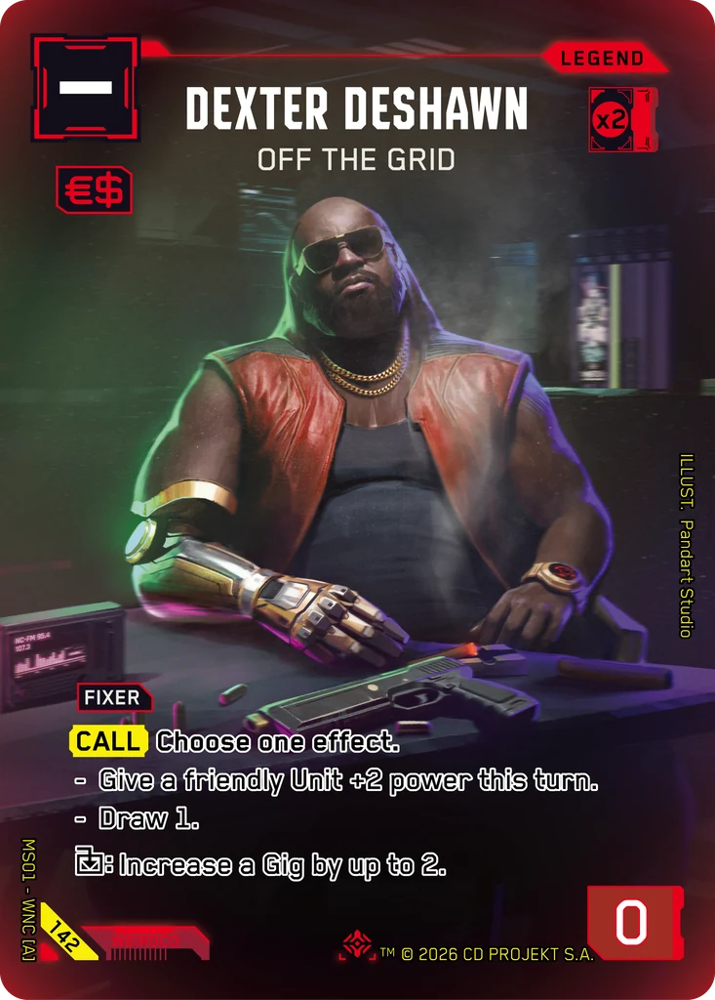
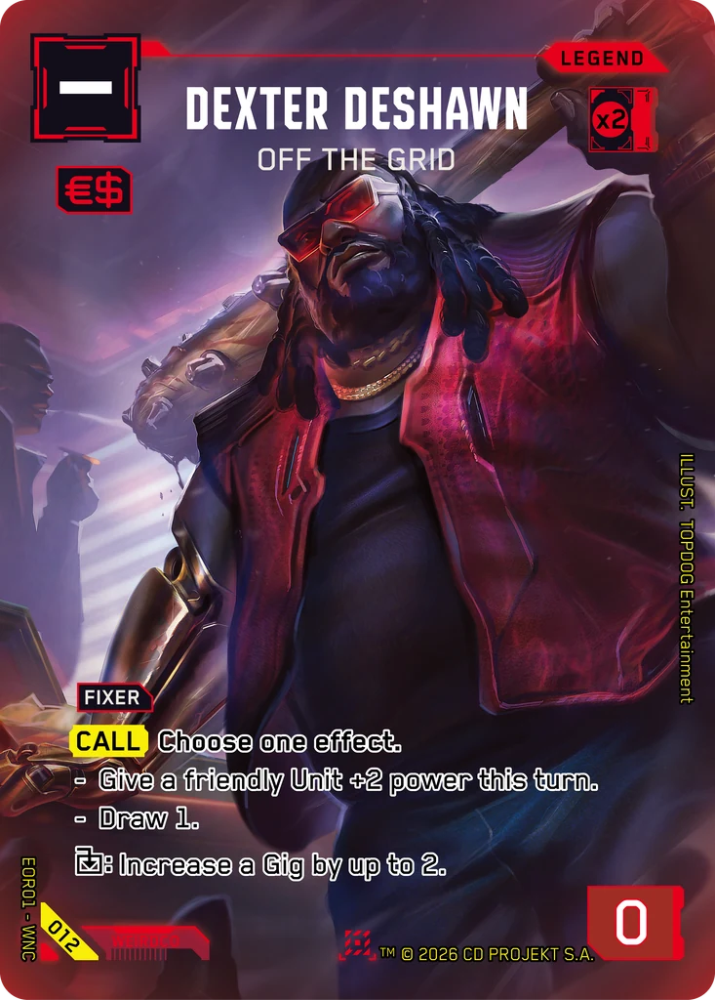

# Dexter DeShawn - Off the Grid

**Type:** Legend  
**Rarity:** Iconic Legend #142  
**Printings:** Beta Iconic Legend β142; Edgerunner Open S 1 Nova 012; Retail Iconic Legend 142  
**Illustrated by:** Pandart Studio, TOPDOG Entertainment

## Images in this folder

| File | Printing |
|---|---|
| [beta-142.webp](beta-142.webp) | Beta Iconic #142 |
| [retail-142.webp](retail-142.webp) | Retail Iconic #142 |
| [nova-012.webp](nova-012.webp) | Nova Rare 012 (Edgerunner Open S 1) |

  

## Full art (linked, not copied)

Out of respect for the Artists and their agreements with ArtStation, their work is linked here instead of re-uploaded.

- https://www.artstation.com/artwork/Y8Gzed

## Official reveals

- 2026-07-17: [post on X](https://x.com/Cyberpunk_TCG/status/2078223502423814145) · [images in this repo](../../../marketing/x-posts/2026-07-17-2078223502423814145)
- 2026-08-12: [post on X](https://x.com/Cyberpunk_TCG/status/2087645625491894457) · [images in this repo](../../../marketing/x-posts/2026-08-12-2087645625491894457)
- 2026-08-22: [post on X](https://x.com/Cyberpunk_TCG/status/2091194242655739957) · [images in this repo](../../../marketing/x-posts/2026-08-22-2091194242655739957)
- 2026-10-17: [post on X](https://x.com/Cyberpunk_TCG/status/2111488415476695263) · [images in this repo](../../../marketing/x-posts/2026-10-17-2111488415476695263)
