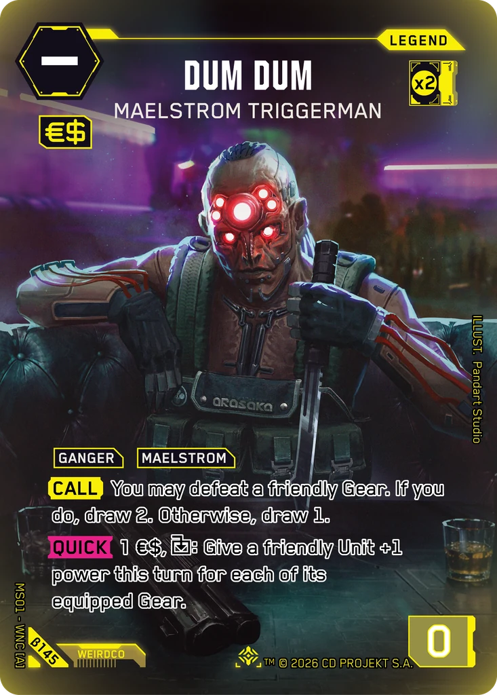
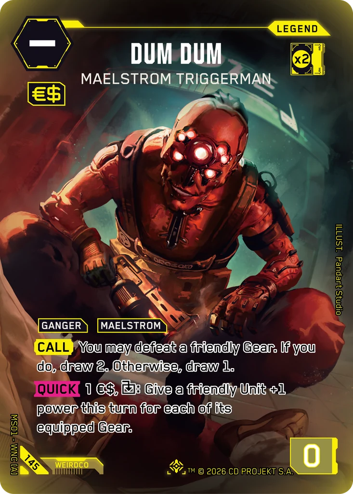
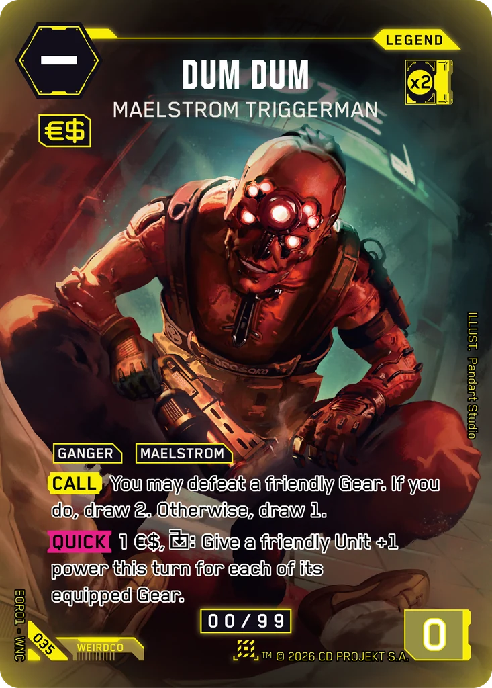

# Dum Dum - Maelstrom Triggerman

**Type:** Legend  
**Rarity:** Iconic Legend #145  
**Printings:** Beta Iconic Legend β145; Edgerunner Open S 1 Nova 035; Retail Iconic Legend 145  
**Illustrated by:** Pandart Studio, Kuya Jaypi, Gaowen Fu

## Images in this folder

| File | Printing |
|---|---|
| [beta-145.webp](beta-145.webp) | Beta Iconic #145 |
| [retail-145.webp](retail-145.webp) | Retail Iconic #145 |
| [nova-035.webp](nova-035.webp) | Nova Rare 035 (Edgerunner Open S 1) |

  

## Full art (linked, not copied)

Out of respect for the Artists and their agreements with ArtStation, their work is linked here instead of re-uploaded.

- https://www.artstation.com/artwork/DYLV1O
- https://www.artstation.com/artwork/rlxLEG
- https://www.artstation.com/artwork/4NAZbY

## Official reveals

- 2026-02-12: [post on X](https://x.com/Cyberpunk_TCG/status/2021993139569823917) · [images in this repo](../../../marketing/x-posts/2026-02-12-2021993139569823917)
- 2026-03-07: [post on X](https://x.com/Cyberpunk_TCG/status/2030327703706993071) · [images in this repo](../../../marketing/x-posts/2026-03-07-2030327703706993071)
- 2026-03-17: [post on X](https://x.com/Cyberpunk_TCG/status/2033963233996833169) · [images in this repo](../../../marketing/x-posts/2026-03-17-2033963233996833169)
- 2026-10-02: [post on X](https://x.com/Cyberpunk_TCG/status/2106127498182266985) · [images in this repo](../../../marketing/x-posts/2026-10-02-2106127498182266985)
