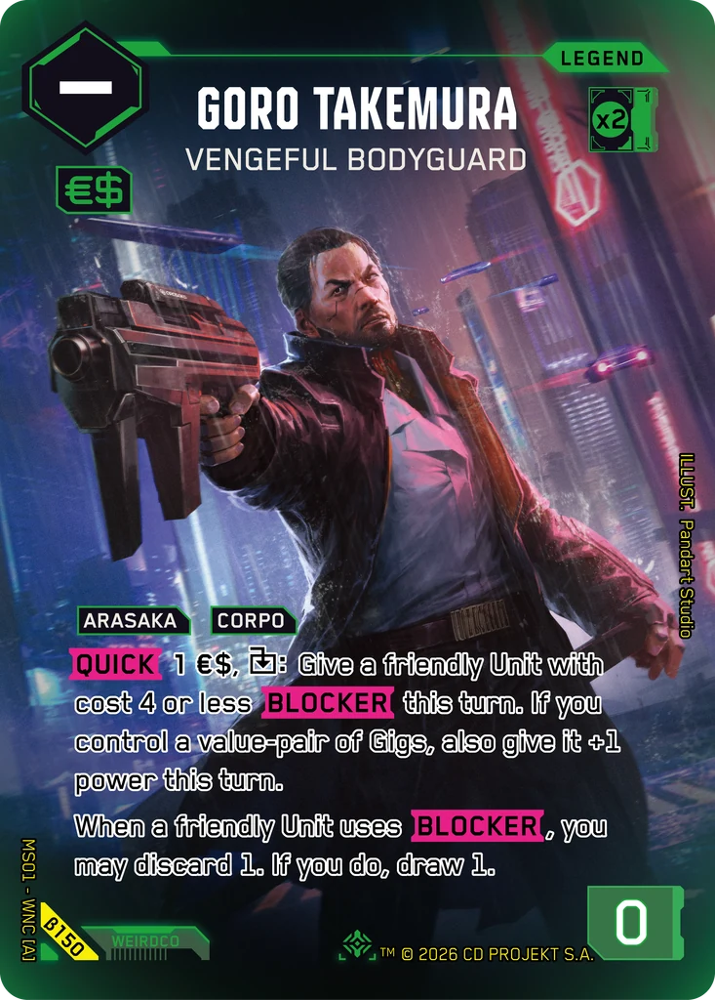
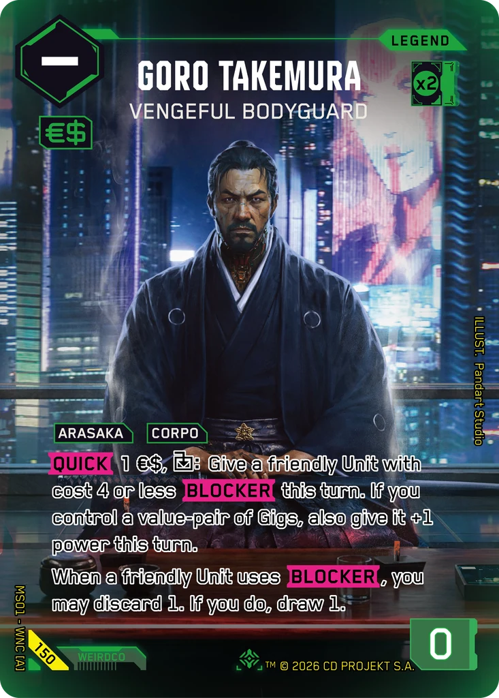
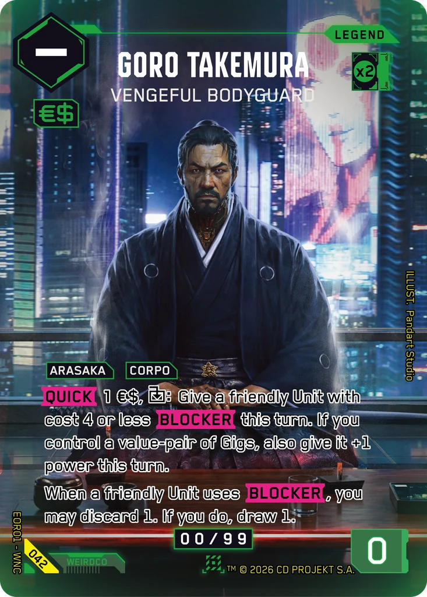

# Goro Takemura - Vengeful Bodyguard

**Type:** Legend  
**Rarity:** Iconic Legend #150  
**Printings:** Beta Iconic Legend β150; Edgerunner Open S 1 Nova 042; Retail Iconic Legend 150  
**Illustrated by:** Pandart Studio, Gaowen Fu

## Images in this folder

| File | Printing |
|---|---|
| [beta-150.webp](beta-150.webp) | Beta Iconic #150 |
| [retail-150.webp](retail-150.webp) | Retail Iconic #150 |
| [nova-042.webp](nova-042.webp) | Nova Rare 042 (Edgerunner Open S 1) |

  

## Full art (linked, not copied)

Out of respect for the Artists and their agreements with ArtStation, their work is linked here instead of re-uploaded.

- https://www.artstation.com/artwork/rlxLEG
- https://www.artstation.com/artwork/dyE10K

## Official reveals

- 2026-03-02: [post on X](https://x.com/Cyberpunk_TCG/status/2028516129040199829) · [images in this repo](../../../marketing/x-posts/2026-03-02-2028516129040199829)
- 2026-04-08: [post on X](https://x.com/Cyberpunk_TCG/status/2041872170985325046) · [images in this repo](../../../marketing/x-posts/2026-04-08-2041872170985325046)
- 2026-04-18: [post on X](https://x.com/Cyberpunk_TCG/status/2045533145534021700) · [images in this repo](../../../marketing/x-posts/2026-04-18-2045533145534021700)
