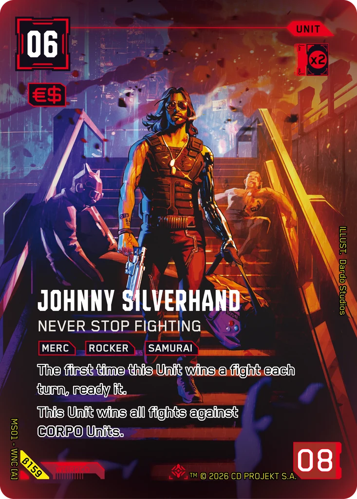
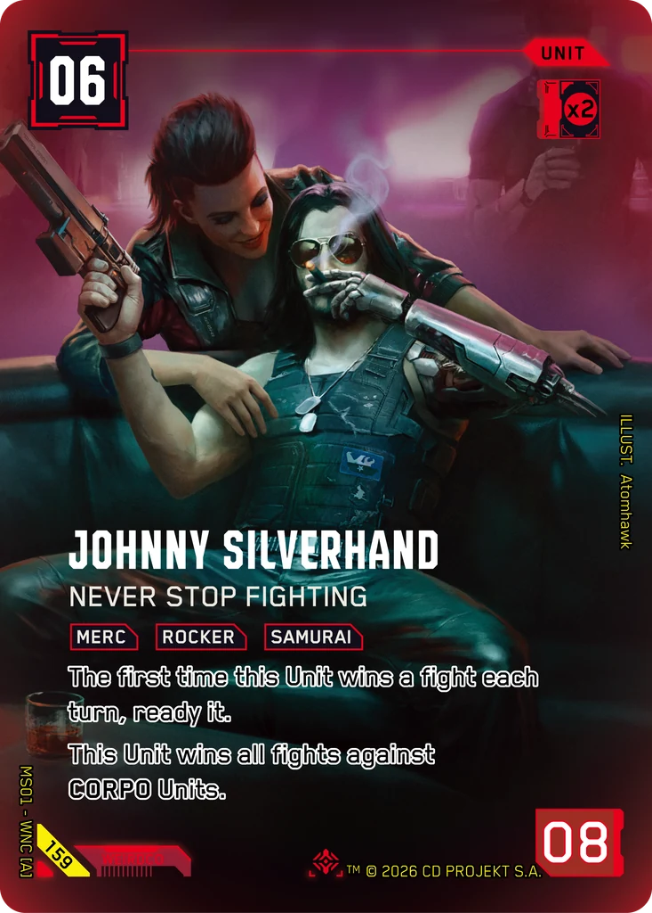

# Johnny Silverhand - Never Stop Fighting

**Type:** Unit  
**Rarity:** Iconic Other #159  
**Printings:** Beta Iconic Other β159; Retail Iconic Other 159  
**Illustrated by:** Dardo Studios, Atomhawk

## Images in this folder

| File | Printing |
|---|---|
| [beta-159.webp](beta-159.webp) | Beta Iconic #159 |
| [retail-159.webp](retail-159.webp) | Retail Iconic #159 |

 

## Full art (linked, not copied)

Out of respect for the Artists and their agreements with ArtStation, their work is linked here instead of re-uploaded.

- https://www.artstation.com/artwork/lERw2k

## Official reveals

- 2026-06-19: [post on X](https://x.com/Cyberpunk_TCG/status/2068001531685720309) · [images in this repo](../../../marketing/x-posts/2026-06-19-2068001531685720309)
- 2026-08-28: [post on X](https://x.com/Cyberpunk_TCG/status/2093443692610650477) · [images in this repo](../../../marketing/x-posts/2026-08-28-2093443692610650477)
- 2026-10-14: [post on X](https://x.com/Cyberpunk_TCG/status/2110476165089493325) · [images in this repo](../../../marketing/x-posts/2026-10-14-2110476165089493325)
