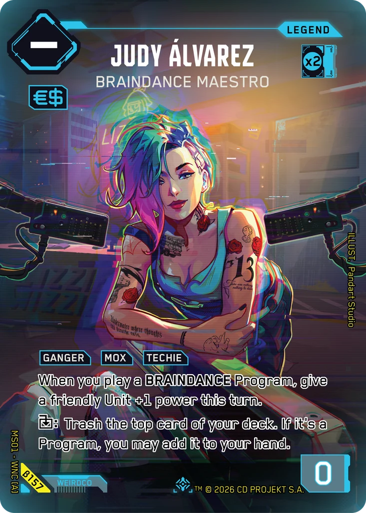
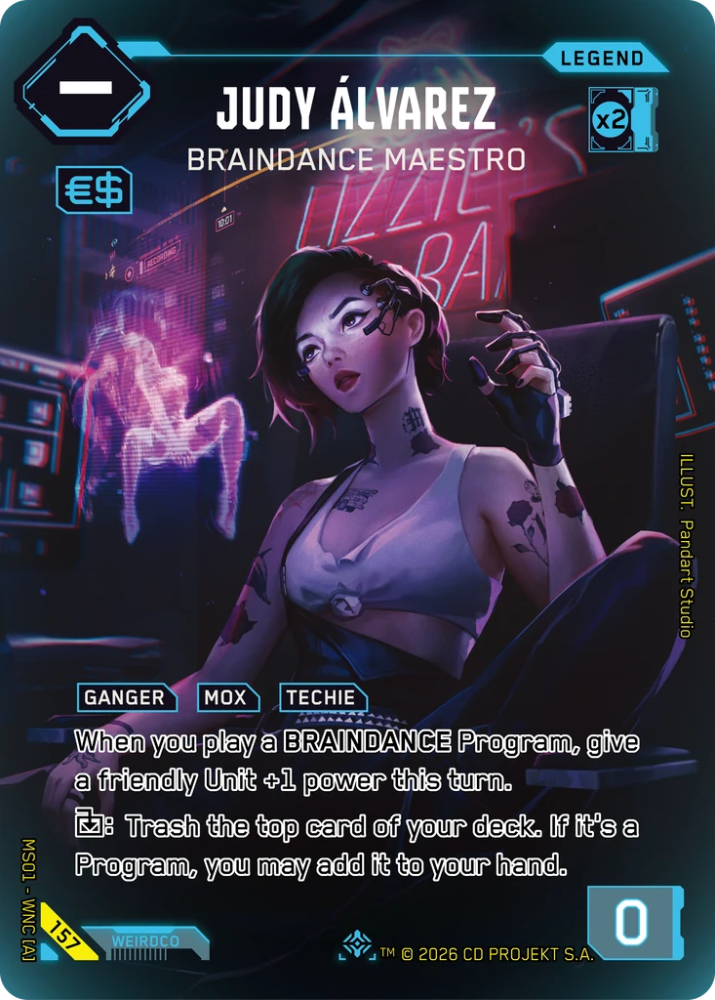
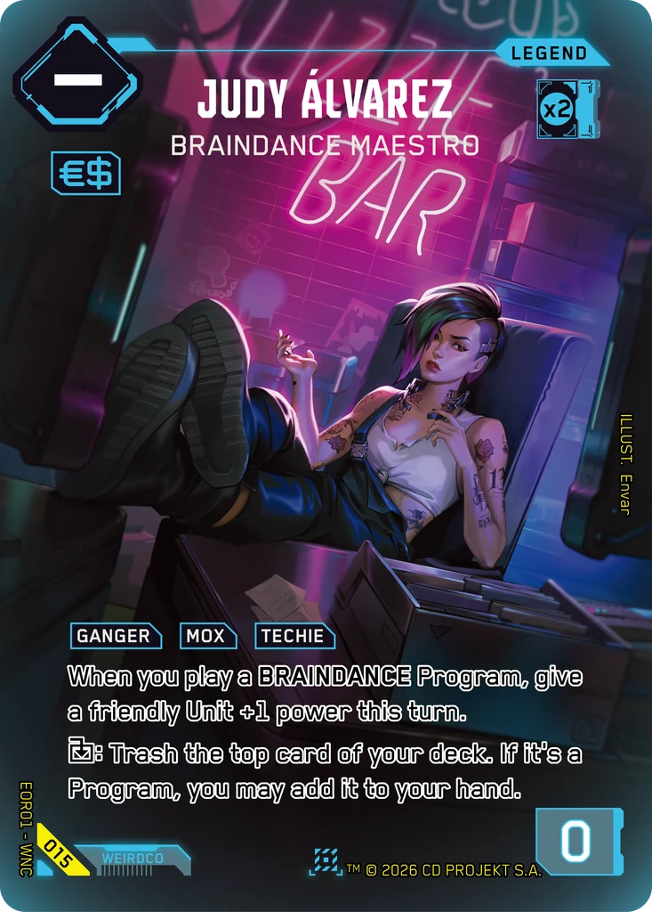

# Judy Álvarez - Braindance Maestro

**Type:** Legend  
**Rarity:** Iconic Legend #157  
**Printings:** Beta Iconic Legend β157; Edgerunner Open S 1 Nova 015; Retail Iconic Legend 157  
**Illustrated by:** Pandart Studio, Envar, Gautier Viller

## Images in this folder

| File | Printing |
|---|---|
| [beta-157.webp](beta-157.webp) | Beta Iconic #157 |
| [retail-157.webp](retail-157.webp) | Retail Iconic #157 |
| [nova-015.webp](nova-015.webp) | Nova Rare 015 (Edgerunner Open S 1) |

  

## Full art (linked, not copied)

Out of respect for the Artists and their agreements with ArtStation, their work is linked here instead of re-uploaded.

- https://www.artstation.com/artwork/x3G5OY
- Regular printing art by Gautier Viller: not mirrored here; see the artist's own pages

## Official reveals

- 2026-02-11: [post on X](https://x.com/Cyberpunk_TCG/status/2021630638747517219) · [images in this repo](../../../marketing/x-posts/2026-02-11-2021630638747517219)
- 2026-03-26: [post on X](https://x.com/Cyberpunk_TCG/status/2037198598622822565) · [images in this repo](../../../marketing/x-posts/2026-03-26-2037198598622822565)
- 2026-07-25: [post on X](https://x.com/Cyberpunk_TCG/status/2081047352178020567) · [images in this repo](../../../marketing/x-posts/2026-07-25-2081047352178020567)
- 2026-09-25: [post on X](https://x.com/Cyberpunk_TCG/status/2103590771404210338) · [images in this repo](../../../marketing/x-posts/2026-09-25-2103590771404210338)
