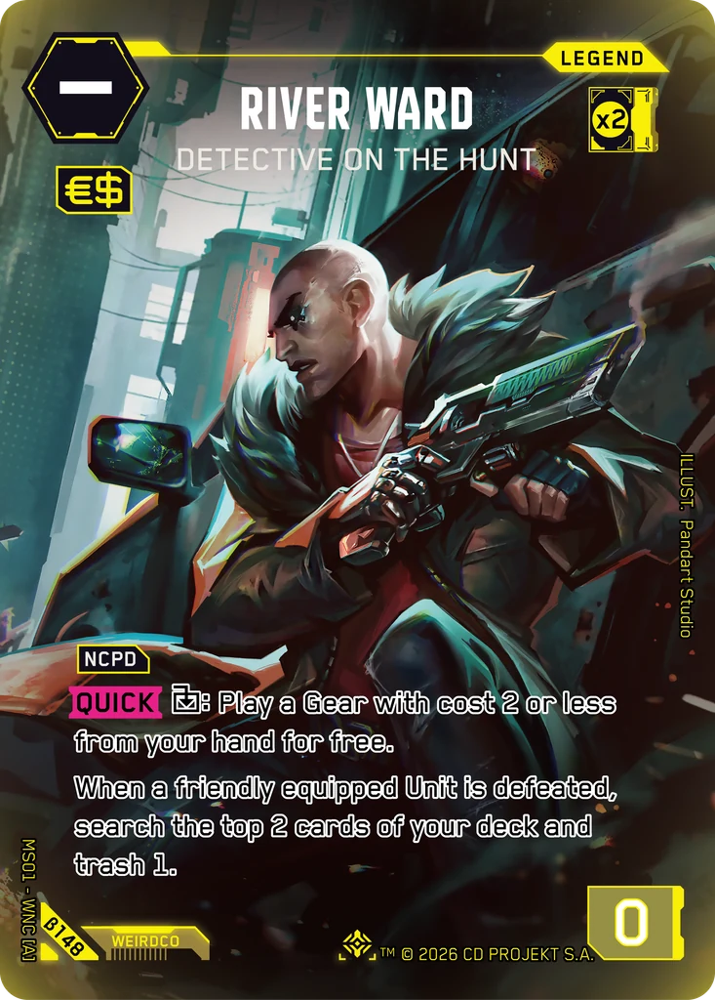
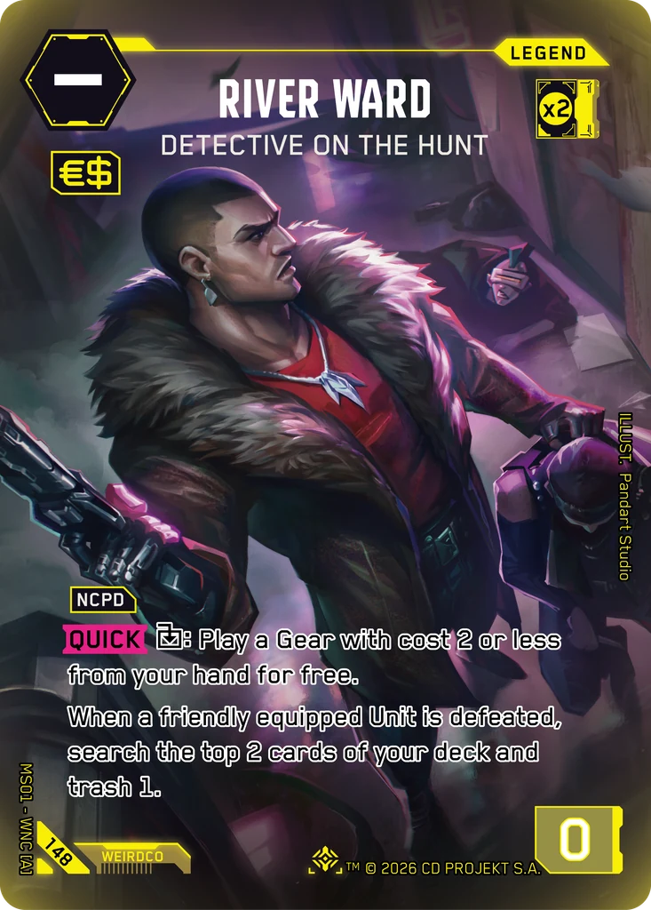
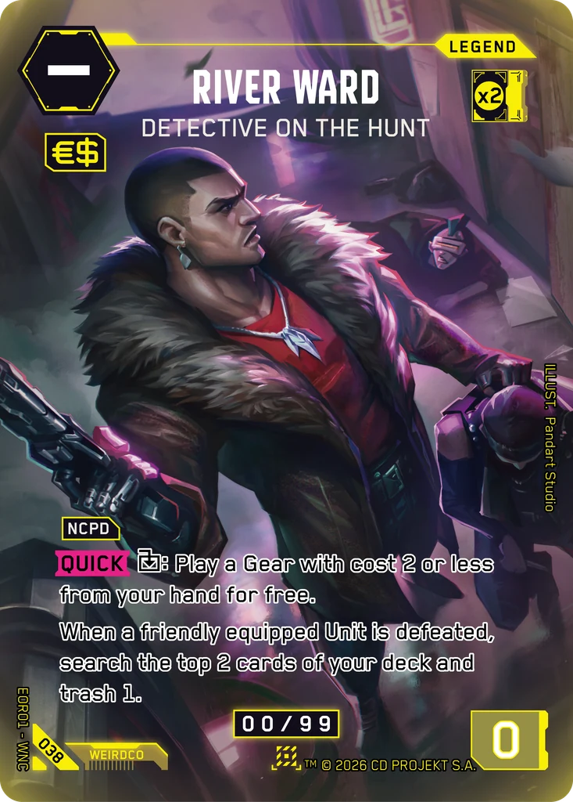

# River Ward - Detective on the Hunt

**Type:** Legend  
**Rarity:** Iconic Legend #148  
**Printings:** Beta Iconic Legend β148; Edgerunner Open S 1 Nova 038; Retail Iconic Legend 148  
**Illustrated by:** Pandart Studio

## Images in this folder

| File | Printing |
|---|---|
| [beta-148.webp](beta-148.webp) | Beta Iconic #148 |
| [retail-148.webp](retail-148.webp) | Retail Iconic #148 |
| [nova-038.webp](nova-038.webp) | Nova Rare 038 (Edgerunner Open S 1) |

  

## Official reveals

- 2026-02-14: [post on X](https://x.com/Cyberpunk_TCG/status/2022717889992622482) · [images in this repo](../../../marketing/x-posts/2026-02-14-2022717889992622482)
- 2026-03-01: [post on X](https://x.com/Cyberpunk_TCG/status/2028153679325319485) · [images in this repo](../../../marketing/x-posts/2026-03-01-2028153679325319485)
- 2026-04-05: [post on X](https://x.com/Cyberpunk_TCG/status/2040614854742933835) · [images in this repo](../../../marketing/x-posts/2026-04-05-2040614854742933835)
- 2026-09-16: [post on X](https://x.com/Cyberpunk_TCG/status/2100329277501682161) · [images in this repo](../../../marketing/x-posts/2026-09-16-2100329277501682161)
