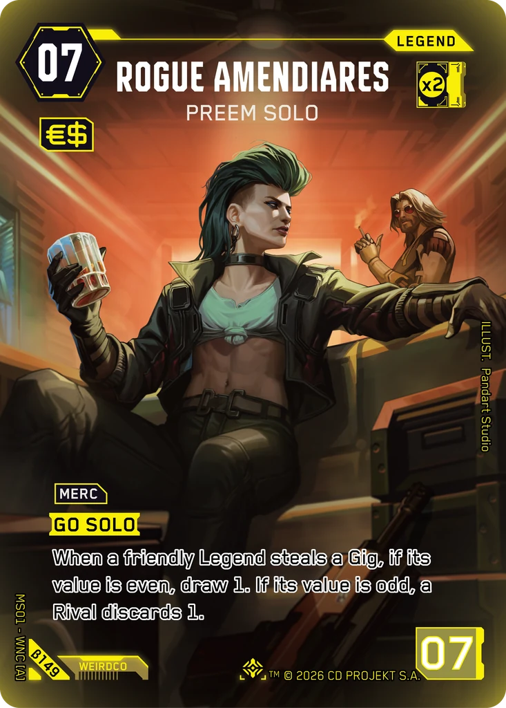
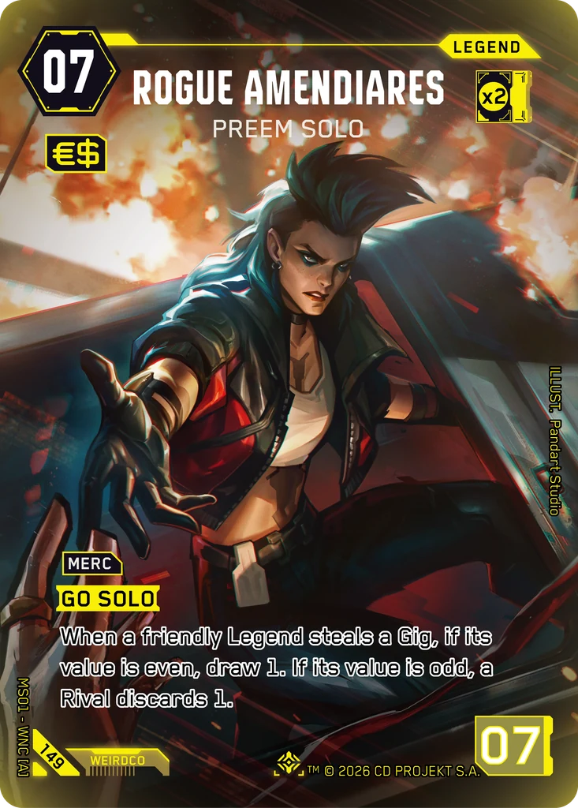
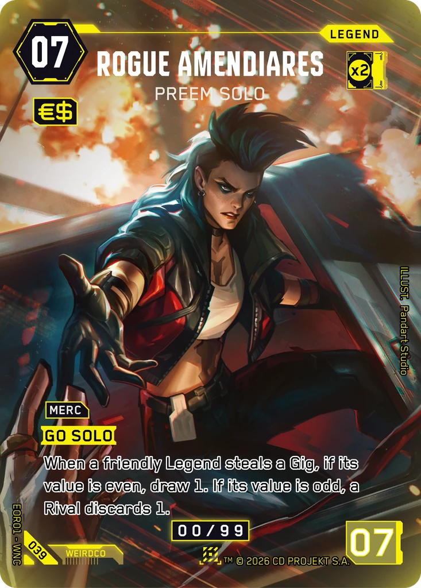

# Rogue Amendiares - Preem Solo

**Type:** Legend  
**Rarity:** Iconic Legend #149  
**Printings:** Beta Iconic Legend β149; Edgerunner Open S 1 Nova 039; Retail Iconic Legend 149  
**Illustrated by:** Pandart Studio

## Images in this folder

| File | Printing |
|---|---|
| [beta-149.webp](beta-149.webp) | Beta Iconic #149 |
| [retail-149.webp](retail-149.webp) | Retail Iconic #149 |
| [nova-039.webp](nova-039.webp) | Nova Rare 039 (Edgerunner Open S 1) |

  

## Official reveals

- 2026-02-13: [post on X](https://x.com/Cyberpunk_TCG/status/2022355588701708515) · [images in this repo](../../../marketing/x-posts/2026-02-13-2022355588701708515)
- 2026-03-27: [post on X](https://x.com/Cyberpunk_TCG/status/2037560928984539465) · [images in this repo](../../../marketing/x-posts/2026-03-27-2037560928984539465)
- 2026-04-08: [post on X](https://x.com/Cyberpunk_TCG/status/2041831415134715973) · [images in this repo](../../../marketing/x-posts/2026-04-08-2041831415134715973)
- 2026-08-08: [post on X](https://x.com/Cyberpunk_TCG/status/2086120688927076425) · [images in this repo](../../../marketing/x-posts/2026-08-08-2086120688927076425)
- 2026-10-05: [post on X](https://x.com/Cyberpunk_TCG/status/2107139808988479924) · [images in this repo](../../../marketing/x-posts/2026-10-05-2107139808988479924)
