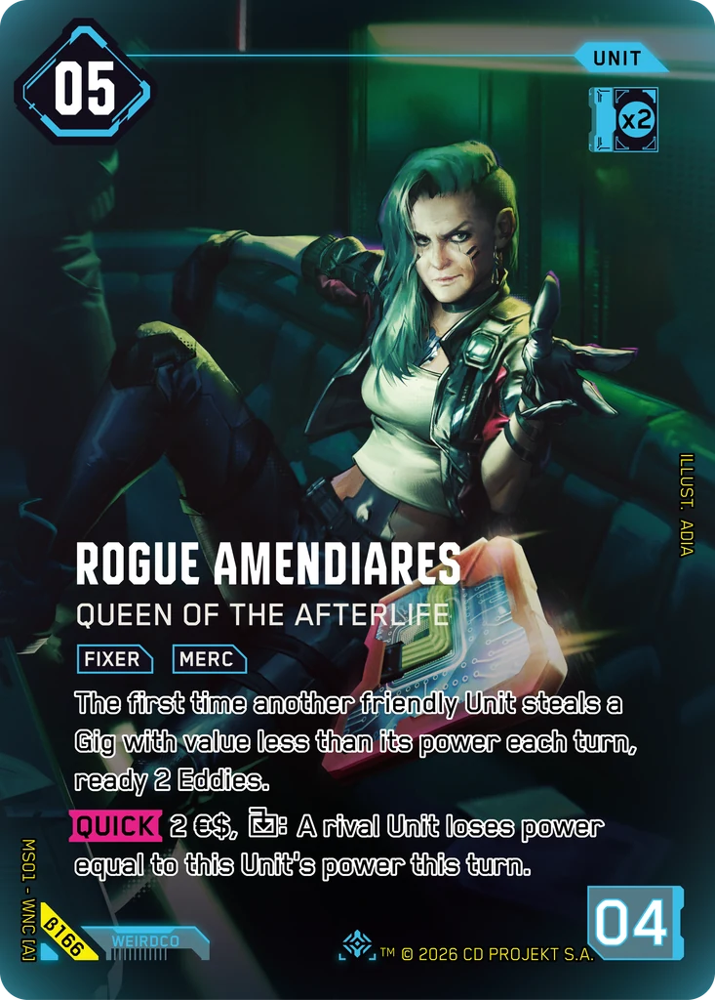
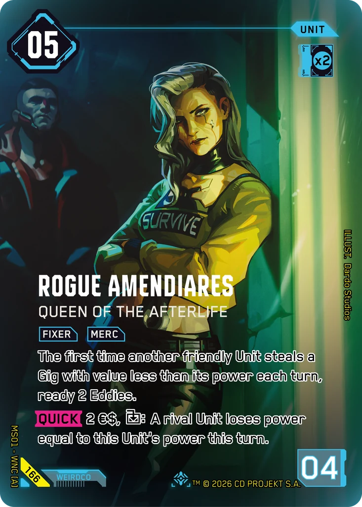

# Rogue Amendiares - Queen of the Afterlife

**Type:** Unit  
**Rarity:** Iconic Other #166  
**Printings:** Beta Iconic Other β166; Retail Iconic Other 166  
**Illustrated by:** ADIA, Dardo Studios, Mooncolony

## Images in this folder

| File | Printing |
|---|---|
| [beta-166.webp](beta-166.webp) | Beta Iconic #166 |
| [retail-166.webp](retail-166.webp) | Retail Iconic #166 |

 

## Full art (linked, not copied)

Out of respect for the Artists and their agreements with ArtStation, their work is linked here instead of re-uploaded.

- https://www.artstation.com/artwork/ZlNbDm
- Regular printing art by Mooncolony: not mirrored here; see the artist's own pages

## Official reveals

- 2026-05-15: [post on X](https://x.com/Cyberpunk_TCG/status/2055318085406457944) · [images in this repo](../../../marketing/x-posts/2026-05-15-2055318085406457944)
- 2026-08-23: [post on X](https://x.com/Cyberpunk_TCG/status/2091556582022590798) · [images in this repo](../../../marketing/x-posts/2026-08-23-2091556582022590798)
- 2026-10-23: [post on X](https://x.com/Cyberpunk_TCG/status/2113737680513089633) · [images in this repo](../../../marketing/x-posts/2026-10-23-2113737680513089633)
