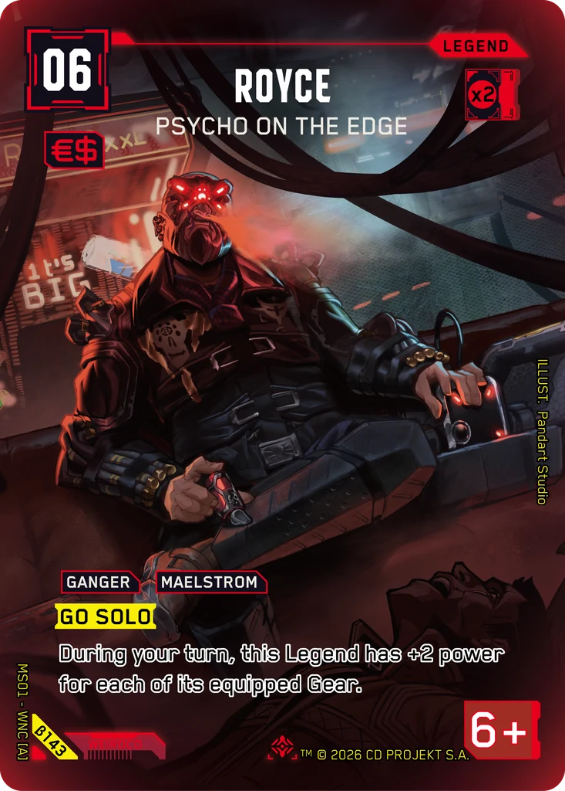
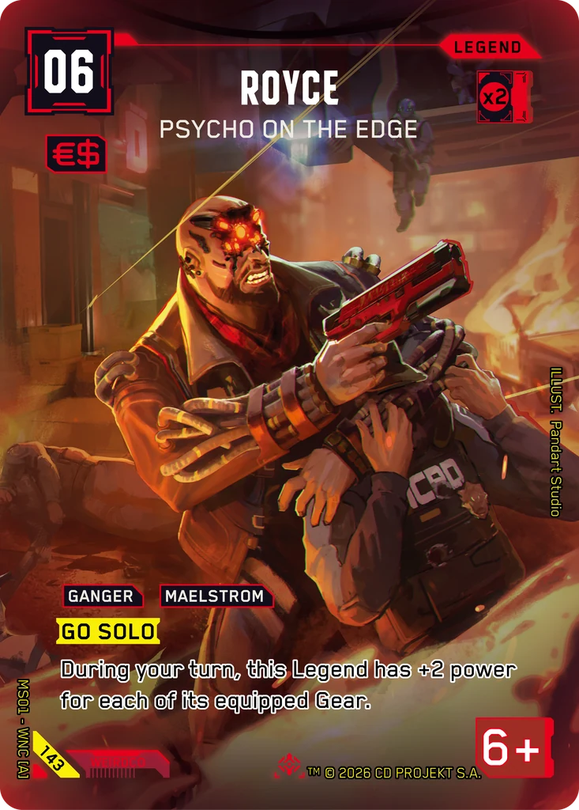
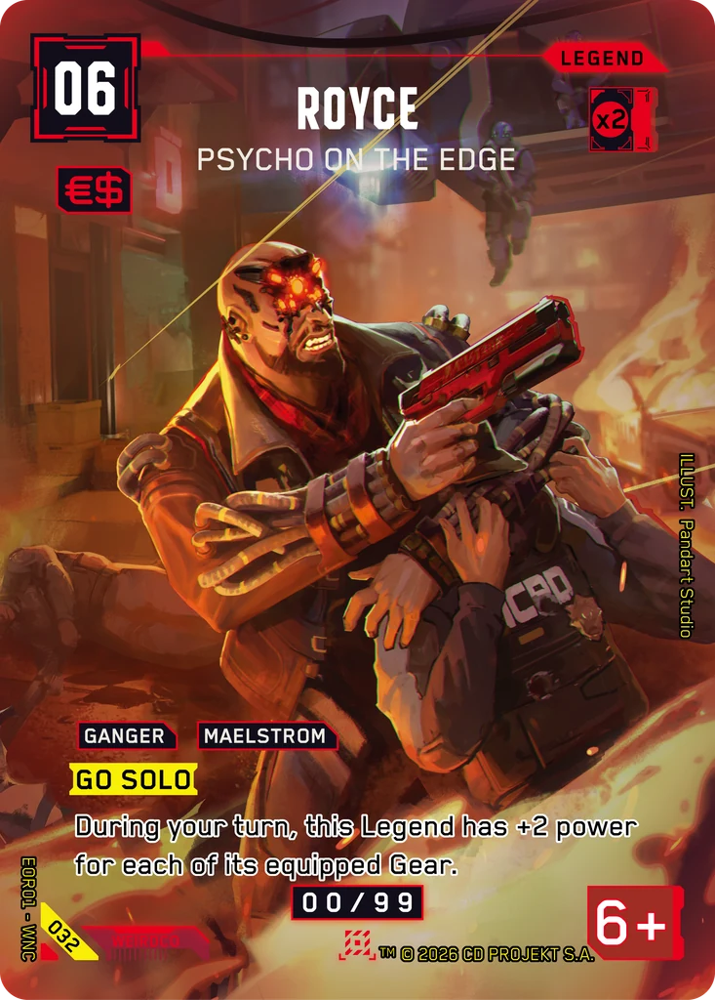

# Royce - Psycho on the Edge

**Type:** Legend  
**Rarity:** Iconic Legend #143  
**Printings:** Beta Iconic Legend β143; Edgerunner Open S 1 Nova 032; Retail Iconic Legend 143  
**Illustrated by:** Pandart Studio, Jacob Schade

## Images in this folder

| File | Printing |
|---|---|
| [beta-143.webp](beta-143.webp) | Beta Iconic #143 |
| [retail-143.webp](retail-143.webp) | Retail Iconic #143 |
| [nova-032.webp](nova-032.webp) | Nova Rare 032 (Edgerunner Open S 1) |

  

## Full art (linked, not copied)

Out of respect for the Artists and their agreements with ArtStation, their work is linked here instead of re-uploaded.

- https://www.artstation.com/artwork/0lAPJ5
- https://www.artstation.com/artwork/rlxLEG

## Official reveals

- 2026-02-15: [post on X](https://x.com/Cyberpunk_TCG/status/2023080179266973734) · [images in this repo](../../../marketing/x-posts/2026-02-15-2023080179266973734)
- 2026-03-10: [post on X](https://x.com/Cyberpunk_TCG/status/2031400313467335127) · [images in this repo](../../../marketing/x-posts/2026-03-10-2031400313467335127)
- 2026-09-18: [post on X](https://x.com/Cyberpunk_TCG/status/2101053995686957497) · [images in this repo](../../../marketing/x-posts/2026-09-18-2101053995686957497)
