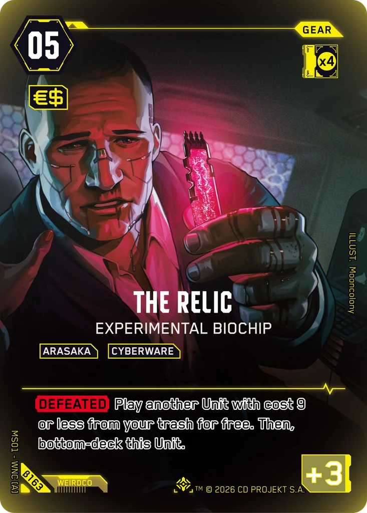
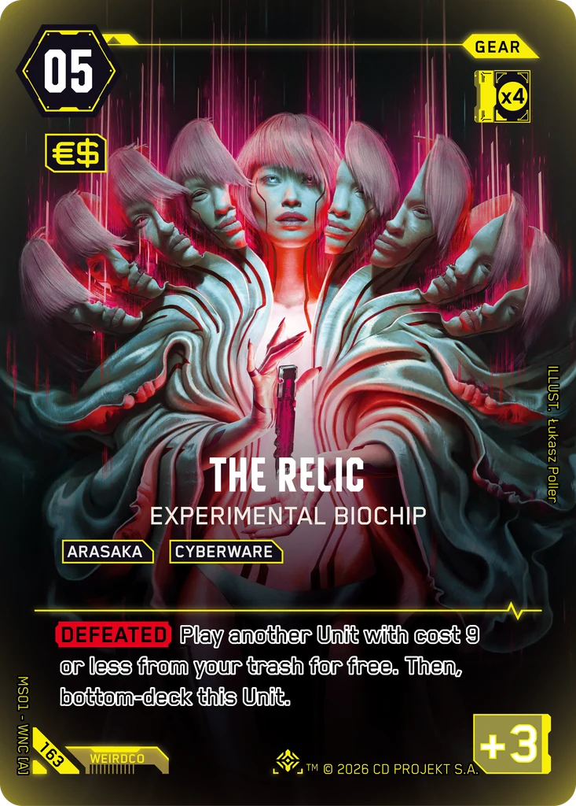

# The Relic - Experimental Biochip

**Type:** Gear  
**Rarity:** Iconic Other #163  
**Printings:** Beta Iconic Other β163; Retail Iconic Other 163  
**Illustrated by:** Mooncolony, Łukasz Poller, Dardo Studios

## Images in this folder

| File | Printing |
|---|---|
| [beta-163.webp](beta-163.webp) | Beta Iconic #163 |
| [retail-163.webp](retail-163.webp) | Retail Iconic #163 |

 

## Full art (linked, not copied)

Out of respect for the Artists and their agreements with ArtStation, their work is linked here instead of re-uploaded.

- https://www.artstation.com/artwork/8vw4Kw
- Regular printing art by Dardo Studios: not mirrored here; see the artist's own pages

## Official reveals

- 2026-07-03: [post on X](https://x.com/Cyberpunk_TCG/status/2073149993829966207) · [images in this repo](../../../marketing/x-posts/2026-07-03-2073149993829966207)
- 2026-08-31: [post on X](https://x.com/Cyberpunk_TCG/status/2094531004249567727) · [images in this repo](../../../marketing/x-posts/2026-08-31-2094531004249567727)
- 2026-09-21: [post on X](https://x.com/Cyberpunk_TCG/status/2102066423174414620) · [images in this repo](../../../marketing/x-posts/2026-09-21-2102066423174414620)
