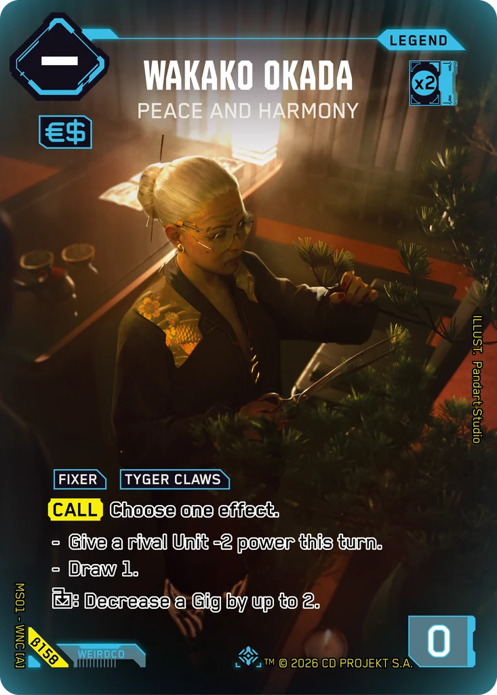
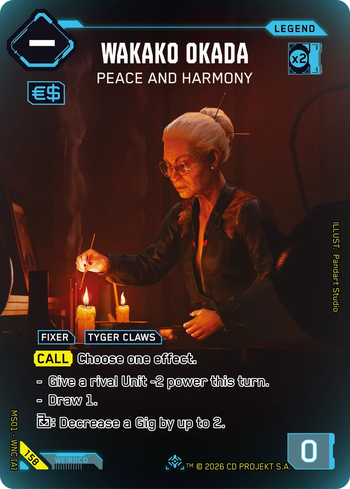
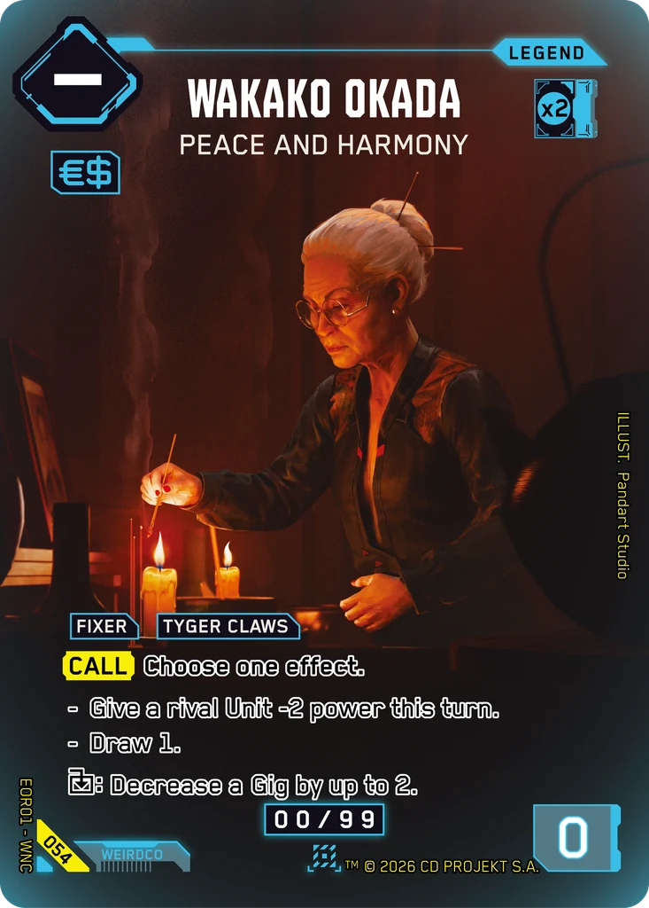

# Wakako Okada - Peace and Harmony

**Type:** Legend  
**Rarity:** Iconic Legend #158  
**Printings:** Beta Iconic Legend β158; Edgerunner Open S 1 Nova 054; Retail Iconic Legend 158  
**Illustrated by:** Pandart Studio, Mooncolony

## Images in this folder

| File | Printing |
|---|---|
| [beta-158.webp](beta-158.webp) | Beta Iconic #158 |
| [retail-158.webp](retail-158.webp) | Retail Iconic #158 |
| [nova-054.webp](nova-054.webp) | Nova Rare 054 (Edgerunner Open S 1) |

  

## Full art (linked, not copied)

Out of respect for the Artists and their agreements with ArtStation, their work is linked here instead of re-uploaded.

- Regular printing art by Mooncolony: not mirrored here; see the artist's own pages

## Official reveals

- 2026-07-31: [post on X](https://x.com/Cyberpunk_TCG/status/2083296876770599100) · [images in this repo](../../../marketing/x-posts/2026-07-31-2083296876770599100)
- 2026-10-24: [post on X](https://x.com/Cyberpunk_TCG/status/2114025313596215785) · [images in this repo](../../../marketing/x-posts/2026-10-24-2114025313596215785)
